<picture>
  <source media="(prefers-color-scheme: dark)" srcset=".github/assets/banner-dark.svg">
  
</picture>

<p align="center">
  <a href="https://aerostack2.vercel.app"></a>
  <a href="https://github.com/aerostack2/aerostack2/actions/workflows/build-humble.yaml"></a>
  <a href="https://github.com/aerostack2/aerostack2/actions/workflows/build-jazzy.yaml"></a>
  <a href="https://github.com/aerostack2/aerostack2/actions/workflows/pixi-build.yaml"></a>
  <a href="https://pixi.sh"></a>
  <a href="https://arxiv.org/abs/2303.18237"></a>
  <a href="LICENSE"></a>
</p>

Aerostack2 is an open source framework for developing multi-robot aerial systems, built on ROS 2.

- **ROS 2 native.** Every component is a ROS 2 node with standard topics, services and actions.
- **Modular.** Controllers, state estimators, behaviors and planners are plugins you can swap without touching the rest of the stack.
- **Platform independent.** The same mission runs in simulation and on real aircraft, so moving from sim to real is a configuration change.
- **Behavior based.** Missions are built from reusable behaviors, driven from Python or behavior trees.
- **Swarm ready.** Multi-drone namespacing and coordination are part of the design, not an add-on.

https://user-images.githubusercontent.com/35956525/231999883-e491aa08-2835-47a9-9c68-5b2936e8594e.mp4

## Quickstart

Binary packages (Humble):

```bash
sudo apt install ros-humble-aerostack2
```

[Pixi](https://pixi.sh) (Humble or Jazzy, Linux and macOS):

```bash
git clone https://github.com/aerostack2/aerostack2.git
cd aerostack2
pixi install            # Humble
pixi install -e jazzy   # Jazzy
```

Docker:

```bash
docker run -it aerostack2/humble   # Jazzy: docker compose -f docker/compose.yaml build jazzy
```

See the [quickstart](https://aerostack2.vercel.app/docs/getting-started/quickstart) for building from source and running your first flight.

## Supported distributions

| ROS 2  | apt | Source | Pixi | Docker |
| ------ | :-: | :----: | :--: | :----: |
| Humble | yes | yes    | yes  | yes    |
| Jazzy  | no  | yes    | yes  | local  |

## Repository layout

| Package                         | Description                                                    |
| ------------------------------- | -------------------------------------------------------------- |
| `aerostack2`                    | Metapackage that pulls in the whole framework                  |
| `as2_core`                      | Core node, platform and sensor base classes, shared utilities  |
| `as2_msgs`                      | Messages, services and actions                                 |
| `as2_aerial_platforms`          | Platform interfaces for Gazebo and the multirotor simulator    |
| `as2_behaviors`                 | Motion, perception, planning, payload and swarm behaviors      |
| `as2_behavior_tree`             | Behavior tree nodes for mission execution                      |
| `as2_motion_controller`         | Motion controller manager and controller plugins               |
| `as2_motion_reference_handlers` | Helpers to send position, speed and trajectory references      |
| `as2_state_estimator`           | State estimator manager and estimation plugins                 |
| `as2_map_server`                | Map server and mapping plugins                                 |
| `as2_python_api`                | Python API to write missions                                   |
| `as2_hardware_drivers`          | Camera and sensor drivers                                      |
| `as2_simulation_assets`         | Gazebo models and worlds                                       |
| `as2_user_interfaces`           | Keyboard teleoperation, alphanumeric viewer and RViz tools     |
| `as2_utilities`                 | Geozones, external object to TF and other tools                |
| `as2_cli`                       | Command line tools                                             |

Real platforms such as Crazyflie, DJI and Tello live in their own repositories, listed in [`more_platforms.repos`](as2_aerial_platforms/more_platforms.repos).

## Documentation

Everything else (concepts, tutorials, platform guides and API reference) is at [aerostack2.vercel.app](https://aerostack2.vercel.app).

## Contributing

Contributions are welcome. Read [CONTRIBUTING.md](CONTRIBUTING.md) and the [Code of Conduct](CODE_OF_CONDUCT.md), then open an [issue](https://github.com/aerostack2/aerostack2/issues) or pull request.

## Citation

If you use Aerostack2 in academic work, please cite:

```bibtex
@article{fernandez2023aerostack2,
  title   = {Aerostack2: A Software Framework for Developing Multi-robot Aerial Systems},
  author  = {Fernandez-Cortizas, Miguel and Molina, Martin and Arias-Perez, Pedro and Perez-Segui, Rafael and Perez-Saura, David and Campoy, Pascual},
  journal = {arXiv preprint arXiv:2303.18237},
  year    = {2023}
}
```

## License

Aerostack2 is released under the [BSD 3-Clause License](LICENSE).
